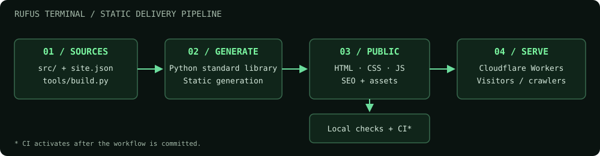

<div align="center">


# />Terminal

**A personal developer portfolio. A technical knowledge base. A space to build, learn and share.**

[**Explore the website**](https://terminal.rutsumello.workers.dev/) · [**Project catalogue**](https://terminal.rutsumello.workers.dev/projets/) · [**Developer profile**](https://github.com/RufusTheDwarf)


</div>

## Contents

[01 Overview](#01--overview) · [02 Features](#02--features) · [03 Project catalogue](#03--project-catalogue) · [04 Site map](#04--site-map) · [05 Architecture](#05--architecture) · [06 Technology stack](#06--technology-stack) · [07 Repository structure](#07--repository-structure) · [08 Getting started](#08--getting-started) · [09 Editing and maintenance](#09--editing-and-maintenance) · [10 Cloudflare deployment](#10--cloudflare-deployment) · [11 SEO and accessibility](#11--seo-and-accessibility) · [12 Testing and quality](#12--testing-and-quality) · [13 Security and contributions](#13--security-and-contributions) · [14 Roadmap and credits](#14--roadmap-and-credits)

<a id="01--overview"></a>
<h2 align="center">Overview // Purpose and principles</h2>


Terminal is my personal corner of the web. I am a computer science student and independent developer interested in infrastructure, systems, networks, cybersecurity, databases, software engineering and game development.

The goal is not simply to display finished products. This portfolio documents practical experiments, technical decisions, limitations and the learning process behind them. It brings together public projects, guides, games and development notes in a terminal-inspired interface.

> Build. Learn. Share. Improve.

The website is written in French (`fr-CH`); the repository documentation is in English. Public availability does not automatically grant permission to reuse third-party assets or code.

<a id="02--features"></a>
<h2 align="center">Features // Explore the portfolio</h2>


| Area | Implementation |
|---|---|
| Portfolio | Profile, technical skills and curated public projects |
| Catalogue | Search, category filters and dedicated project pages |
| Terminal | Simulated commands, navigation, session history and clear command |
| Knowledge | Guides, game-development resources and development logs |
| Design | Forest CRT Glass and Sage Day themes, wide editorial layout, aligned project directory, glass reserved for the terminal and one optional homepage animation |
| Delivery | Pre-generated HTML, shared local CSS/JS and Cloudflare static assets |
| Discoverability | Per-page metadata, sitemap, canonical URLs and internal navigation |

The interactive terminal is a browser UI, **not** a real shell or remote command-execution service. The catalogue and its links are available without JavaScript.

| Command | Purpose |
|---|---|
| `help`, `whoami`, `ls` | Discover commands, profile and sections |
| `skills`, `projects`, `games`, `guides`, `devlog` | Navigate to the corresponding content |
| `search docker` | Open catalogue with a search query |
| `filter infra` | Open the infrastructure category (`all`, `infra`, `security`, `dev`, `games`, `guides`) |
| `contact`, `github` | Find community links or the GitHub profile |
| `clear` | Clear displayed terminal output |
| Up / Down arrows | Browse the session command history |

<a id="03--project-catalogue"></a>
<h2 align="center">Project catalogue // Public projects and resources</h2>


The 18 entries below are a curated snapshot, not a live GitHub API feed. Status labels describe the documented projects and are not independent production-readiness certifications.

| Project | Description | Status | GitHub |
|---|---|---|---|
| [Cloud Project K3s](https://terminal.rutsumello.workers.dev/projets/cloud-project-k3s/) | Two-node private-cloud laboratory with Helpdesk and PostgreSQL | In progress | [Source](https://github.com/RufusTheDwarf/Cloud-Project-K3s) |
| [Docker Network Toolkit](https://terminal.rutsumello.workers.dev/projets/docker-network-toolkit/) | Containerized network laboratory with Nginx, Nmap and iperf3 | Lab operational (reported) | [Source](https://github.com/RufusTheDwarf/Docker-Network-Toolkit) |
| [OpenSSH Security Lab](https://terminal.rutsumello.workers.dev/projets/openssh-security-lab/) | Remote administration, public-key authentication and least privilege | Documented lab | [Source](https://github.com/RufusTheDwarf/OpenSSH-Security-Lab) |
| [RUX NetMap](https://terminal.rutsumello.workers.dev/apps/rux-netmap/) | Windows IPv4 inventory, map and exports | Published Windows application | [Source](https://github.com/RufusTheDwarf/Rux-NetMap) |
| [SkyConnect-DB](https://terminal.rutsumello.workers.dev/projets/skyconnect-db/) | Airport relational database engineering with MySQL and MERISE | In development | [Source](https://github.com/RufusTheDwarf/SkyConnect-DB) |
| [NetRecon Lab](https://terminal.rutsumello.workers.dev/projets/netrecon-lab/) | Authorized network audit and infrastructure preparation | In preparation | [Source](https://github.com/RufusTheDwarf/NetRecon-Lab) |
| [Mission SQL Cinéma](https://terminal.rutsumello.workers.dev/projets/sql-server-project/) | Cinema-themed relational database exercises and Flask interface | Educational project | [Source](https://github.com/RufusTheDwarf/SQL_Server_project) |
| [Couteau Suisse](https://terminal.rutsumello.workers.dev/projets/couteau-suisse/) | Windows console toolkit for Morse, base conversion and Unicode steganography | Console utility | [Source](https://github.com/RufusTheDwarf/CouteauSuisse) |
| [Chococoa Web](https://terminal.rutsumello.workers.dev/projets/chococoa-web/) | French multi-page chocolate-themed website | Web project | [Source](https://github.com/RufusTheDwarf/chococoa-web) |
| [Rufus Terminal](https://terminal.rutsumello.workers.dev/projets/rufus-terminal/) | Static developer portfolio and technical project catalogue | v0.7.0 | [Source](https://github.com/RufusTheDwarf/Rufus-Terminal) |
| [Parfum Empire](https://terminal.rutsumello.workers.dev/projets/parfum-empire/) | 2D perfume tycoon with crafting, automation and progression | Evolving game | [Source](https://github.com/RufusTheDwarf/parfum-empire) |
| [Code Quest](https://terminal.rutsumello.workers.dev/projets/code-quest/) | Educational terminal RPG with technical questions and progression | Game project | [Source](https://github.com/RufusTheDwarf/Code_Quest) |
| [Flash Archive](https://terminal.rutsumello.workers.dev/projets/flash-archive/) | Flash preservation project using archived SWF files and Ruffle | Archive | [Source](https://github.com/RufusTheDwarf/Play-old-Flash-games) |
| [Roblox Tycoon Blueprint](https://terminal.rutsumello.workers.dev/projets/roblox-tycoon-blueprint/) | Documentation of tycoon systems, economy and development practices | Knowledge base | [Source](https://github.com/RufusTheDwarf/Roblox-Tycoon-Blueprint) |
| [Minecraft Server Template](https://terminal.rutsumello.workers.dev/projets/minecraft-server-template/) | Reusable Codespaces template for Minecraft server setup | Template | [Source](https://github.com/RufusTheDwarf/mc-server-template) |
| [Minecraft Server](https://terminal.rutsumello.workers.dev/projets/minecraft-server/) | Guide to Minecraft Java hosting and management | Guide | [Source](https://github.com/RufusTheDwarf/Minecraft-Server) |
| [Git Signed Commits Windows](https://terminal.rutsumello.workers.dev/projets/git-signed-commits-windows/) | SSH commit-signing guide for Windows | Guide | [Source](https://github.com/RufusTheDwarf/git-signed-commits-windows) |
| [Verified by Default](https://terminal.rutsumello.workers.dev/projets/verified-by-default/) | Trust and signature verification workflow for AI-assisted development | Policy guide | [Source](https://github.com/RufusTheDwarf/verified-by-default) |

<a id="04--site-map"></a>
<h2 align="center">Site map // Navigation and routes</h2>


| Route | Purpose |
|---|---|
| [`/`](https://terminal.rutsumello.workers.dev/) | Home, featured projects, terminal, skills and community |
| [`/a-propos/`](https://terminal.rutsumello.workers.dev/a-propos/) | Developer profile and philosophy |
| [`/projets/`](https://terminal.rutsumello.workers.dev/projets/) | Full searchable project catalogue |
| `/projets/<slug>/` | 17 individual project pages |
| [`/apps/`](https://terminal.rutsumello.workers.dev/apps/) | Dedicated application catalogue |
| `/apps/rux-netmap/` | RUX downloads and documentation |
| [`/jeux/`](https://terminal.rutsumello.workers.dev/jeux/) | Game-development projects |
| [`/guides/`](https://terminal.rutsumello.workers.dev/guides/) | Technical guides and documentation |
| [`/devlog/`](https://terminal.rutsumello.workers.dev/devlog/) | Development notes |
| [`/journal/`](https://terminal.rutsumello.workers.dev/journal/) | Personal notes and activities |
| [`/lab/`](https://terminal.rutsumello.workers.dev/lab/) | Temporary browser workspace |
| `404.html` | Custom error page (excluded from sitemap) |

Nine main pages plus eighteen detail pages form the **27 indexable URLs**. The custom error document brings the total to **28 HTML files**.

<a id="05--architecture"></a>
<h2 align="center">Architecture // How the site is built</h2>


<div align="center">

</div>

The source of truth is the project data, shared CSS/JS, site configuration and Python generator. The build writes a self-contained static website into `public/`. Commit this generated output so Cloudflare can serve it without a production build or runtime framework.

There is no application database, user account system, server-side shell or analytics integration. The read-only GitHub catalogue audit detects new public repositories without publishing unreviewed content.

<a id="06--technology-stack"></a>
<h2 align="center">Technology stack // Tools and technologies</h2>


| Technology | Role |
|---|---|
| HTML5 | Semantic content, navigation and metadata |
| CSS | Layout, terminal aesthetic, responsive and accessibility styles |
| Vanilla JavaScript | Catalogue filtering and simulated terminal |
| Python 3.10+ | Static generation and standard-library validation |
| JSON | Site settings and editorial project data |
| Cloudflare Workers | Static asset hosting and routing |
| Git / GitHub | Source control, collaboration and signed commits |
| Playwright / Chromium | Optional isolated browser validation |
| Lighthouse CI | Automated quality measurement when workflow is enabled |

Node.js is used for optional syntax checking and Wrangler tooling, not for serving the website. Astro is not required by the current implementation.

<a id="07--repository-structure"></a>
<h2 align="center">Repository structure // Source and generated files</h2>


```text
Rufus-Terminal/
├── .github/workflows/
│   ├── quality.yml                # Build and quality checks
│   └── catalogue.yml              # Public repository audit
├── .vscode/settings.json
├── docs/readme/                   # README SVG illustrations
├── public/                        # Generated, deployable website
│   ├── assets/
│   │   ├── style.css
│   │   ├── site.js
│   │   ├── ambient-map.svg
│   │   ├── rux-diagram.svg
│   │   ├── theme.js
│   │   ├── forest-terminal.svg
│   │   ├── day-terminal.svg
│   │   └── social-card.png
│   ├── a-propos/index.html
│   ├── apps/                      # Application catalogue and RUX
│   ├── projets/
│   │   ├── index.html
│   │   └── <slug>/index.html       # 17 individual pages
│   ├── jeux/index.html
│   ├── guides/index.html
│   ├── devlog/index.html
│   ├── journal/index.html
│   ├── lab/index.html
│   ├── index.html
│   ├── 404.html
│   ├── robots.txt
│   ├── sitemap.xml
│   ├── favicon.svg
│   ├── favicon.ico
│   ├── apple-touch-icon.png
│   └── _headers
├── src/
│   ├── projects.json
│   ├── journal.json
│   ├── lab.html
│   ├── lab.js
│   ├── lab.css
│   ├── style.css
│   ├── site.js
│   ├── theme.js
│   ├── forest-terminal.svg
│   └── day-terminal.svg
├── tools/
│   ├── build.py
│   ├── check.py
│   ├── browser_check.py
│   ├── lab_check.py
│   ├── sync_github.py
│   └── test_sync_github.py
├── .editorconfig
├── .prettierrc.json
├── .prettierignore
├── .gitignore
├── lighthouserc.json
├── site.json
├── wrangler.jsonc
├── VALIDATION.md
├── SECURITY.md
├── LICENSE
└── README.md
```

This tree shows the main files in v0.7.0. The source and published copies of CSS/JS must remain synchronized through the generator.

<a id="08--getting-started"></a>
<h2 align="center">Getting started // Run the site locally</h2>


### Prerequisites

- Git and Python 3.10 or later for local development.
- Node.js only for the optional JavaScript syntax check, Lighthouse or manual Wrangler deployment.
- VS Code or any text editor.

### Windows (PowerShell)

```powershell
git clone https://github.com/RufusTheDwarf/Rufus-Terminal.git
Set-Location Rufus-Terminal
py -m http.server 8000 --directory public
```

Open <http://localhost:8000/> and press `Ctrl+C` in the terminal when finished.

### Linux / macOS

```bash
git clone https://github.com/RufusTheDwarf/Rufus-Terminal.git
cd Rufus-Terminal
python3 -m http.server 8000 --directory public
```

The Python development server does not reproduce Cloudflare-specific headers, redirects or custom HTTP 404 handling. Always deploy the entire `public/` directory, not just `index.html`.

<a id="09--editing-and-maintenance"></a>
<h2 align="center">Editing and maintenance // Update content and themes</h2>


| Task | Source file |
|---|---|
| Add or update a project | `src/projects.json` |
| Change visual styles | `src/style.css` |
| Change interactions | `src/site.js` |
| Change theme initialization | `src/theme.js` |
| Change theme artwork | `src/forest-terminal.svg`, `src/day-terminal.svg` |
| Edit page layouts, sections and generated metadata | `tools/build.py` |
| Change version or canonical origin | `site.json` |
| Update sharing art or favicons | Local assets in `public/` |

Every project entry has a slug, category, status, technologies, summary, context, technical details, learning goals, limitations and related project slugs. Keep links accurate and avoid exposing private repositories. For RUX, the `downloads` array specifies explicitly reviewed release assets. Links resolve to the latest public release; keep the filenames stable. The SHA-256 checksum is not an Authenticode signature.

After editing, regenerate and validate:

```powershell
py tools/build.py
py tools/check.py
node --check public/assets/site.js
git diff --stat
```

Do not directly edit generated HTML or the generated CSS/JS copies: regeneration overwrites them. When deleting a project, remove its old generated folder from `public/projets/` and rerun the checker.

VS Code: `Shift+Alt+F` formats the active file and `Alt+Z` toggles word wrap. EditorConfig and Prettier configuration define formatting conventions; generated output is excluded from Prettier. Install the Prettier extension if you want to use it for supported source files.

### Catalogue audit

The read-only workflow `catalogue.yml` runs each Monday at 06:25 UTC and can be started manually. It checks public repositories, excluding the profile repository, and produces a JSON report. It does not create commits or publish content. New repositories and entries no longer publicly visible cause exit code 2, so the discrepancy is visible in Actions. Review the report, update the editorial catalogue, regenerate and sign the change locally.

```powershell
py tools/sync_github.py --output github-catalogue-report.json
py tools/build.py
py tools/check.py
```

The report also includes the last push timestamp and archived status of matching public repositories. A matching name does not prove that the editorial description is current. Review significant releases and README changes separately.

<a id="10--cloudflare-deployment"></a>
<h2 align="center">Cloudflare deployment // Publish static assets</h2>


The deployment target is Cloudflare **Workers static assets**, not Cloudflare Pages. The checked-in `wrangler.jsonc` declares the Worker name, compatibility date, `./public` asset directory, trailing-slash routing and custom 404 handling.

| Setting | Value |
|---|---|
| Worker | `terminal` |
| Static directory | `./public` |
| HTML handling | `auto-trailing-slash` |
| Not found handling | `404-page` |
| Current configured origin | [https://terminal.rutsumello.workers.dev](https://terminal.rutsumello.workers.dev/) |

For the existing Git integration, keep the established deployment command and review the Cloudflare deployment logs. For a manual deployment, with Node.js installed and the correct Cloudflare account authenticated:

```bash
npx wrangler deploy
```

To switch to a final custom domain, update `siteUrl` in `site.json`, regenerate, validate and deploy. Avoid having equivalent preview and production URLs both indexed. A repository commit is not proof of a successful live deployment.

See [Cloudflare static assets](https://developers.cloudflare.com/workers/static-assets/) and [asset routing](https://developers.cloudflare.com/workers/static-assets/routing/).

<a id="11--seo-and-accessibility"></a>
<h2 align="center">SEO and accessibility // Discoverability and usability</h2>


| Implemented in static output | Requires live verification |
|---|---|
| Unique titles, descriptions and canonical URLs | Actual HTTP response status and headers |
| XML sitemap and robots.txt | Search Console and Bing registration |
| Open Graph and Twitter/X cards | Sharing preview rendering |
| JSON-LD structured data and breadcrumbs | Search engine processing |
| Semantic headings, focus indicators and skip link | Full accessibility audit |
| Responsive grid, fluid sizing and reduced motion | Device and assistive-technology testing |
| Shared local assets | Real-world Core Web Vitals |

[Sitemap](https://terminal.rutsumello.workers.dev/sitemap.xml) · [robots.txt](https://terminal.rutsumello.workers.dev/robots.txt)

After deployment, check the real canonical domain, submit the sitemap in [Google Search Console](https://search.google.com/search-console/) and [Bing Webmaster Tools](https://www.bing.com/webmasters/), and measure performance with [PageSpeed Insights](https://pagespeed.web.dev/). Use the [Google SEO starter guide](https://developers.google.com/search/docs/fundamentals/seo-starter-guide) as a reference.

Technical SEO improves discoverability; it does not guarantee crawling, indexing or a particular ranking. Original, useful technical content and relevant references remain essential.

<a id="12--testing-and-quality"></a>
<h2 align="center">Testing and quality // Reproduce the checks</h2>


### Previous validation for v0.4.1 (historical)

| Check | Recorded result |
|---|---|
| Static generator | 24 indexable pages + one error page |
| Static checker | 25 HTML pages, 18 project pages, 598 internal references |
| JavaScript syntax | Passed |
| Isolated Chromium rendering | 250 page/viewport/theme combinations; no horizontal overflow |
| Catalogue and terminal | Search, filters, help, history and safe text rendering passed |
| No-JS catalogue | Passed |

See [VALIDATION.md](VALIDATION.md) for the validation report. These results concern the preparation environment and are not live HTTP or independent production audit results.

### Reproduce checks

```powershell
py tools/build.py
py tools/check.py
node --check public/assets/site.js
```

Optional browser checks:

```powershell
py -m pip install playwright
py -m playwright install chromium
py tools/browser_check.py
```

The browser script inlines local resources during isolated rendering; it does not validate actual CSP enforcement or Cloudflare routing.

### Continuous integration

The release restores `.github/workflows/quality.yml`. Once committed, it runs on pushes to `main`, pull requests and manual dispatch, verifies regenerated output and runs Lighthouse CI. Catalogue comparison unit tests run in the same workflow. The configuration targets performance ≥90 and accessibility, best practices and SEO ≥95 as **warnings**, not hard failures or measured scores. Check the [Actions tab](https://github.com/RufusTheDwarf/Rufus-Terminal/actions) for real results after installation.

<a id="13--security-and-contributions"></a>
<h2 align="center">Security and contributions // Responsible development</h2>


The static site uses local resources and a restricted CSP configured in `public/_headers`, alongside frame, MIME-sniffing, permissions and referrer protections. Live enforcement must be checked after deployment. The terminal displays user input as text rather than evaluating commands.

Read [SECURITY.md](SECURITY.md) before reporting security issues. Do not publish secrets, private keys, credentials or private infrastructure details. Keep security experiments authorized and respect third-party licenses.

For contributions, create a focused branch, edit the source, regenerate the output, run the checks and review the diff. Use a trusted signing identity:

```bash
git add .
git commit -S -m "feat: update catalogue and restore quality checks"
git push
```

For other changes, stage the actual modified source and generated files instead. Verify the commit signature locally and confirm GitHub's actual `Verified` status; signing alone does not guarantee that status. See [SSH signing guide](https://github.com/RufusTheDwarf/git-signed-commits-windows) and [Verified by Default](https://github.com/RufusTheDwarf/verified-by-default).

<a id="14--roadmap-and-credits"></a>
<h2 align="center">Roadmap and credits // Next steps and acknowledgements</h2>


### Roadmap

- [x] Static multipage portfolio and project catalogue
- [x] Responsive terminal UI and shared assets
- [x] Static SEO metadata, sitemap and canonical URLs
- [x] Python generation and local validation tooling
- [ ] Commit the restored CI and formatting configuration; inspect workflow results
- [ ] Verify Cloudflare HTTP routing, response headers and live performance
- [ ] Register and inspect search engine indexing
- [ ] Publish detailed original guides and development logs
- [x] Add a read-only GitHub catalogue audit
- [ ] Review the first scheduled catalogue report
- [ ] Expand accessibility and regression testing

### License and acknowledgements

The source code is distributed under the [MIT License](LICENSE). Personal branding, artwork and third-party content may have separate rights; consult the corresponding repository and asset licenses before reuse.

Thanks to the open-source communities behind Python, Git, Playwright, Chromium and Lighthouse, and to Cloudflare for its static asset platform. README graphics use the original [Capsule Render](https://github.com/kyechan99/capsule-render), [Readme Typing SVG](https://github.com/DenverCoder1/readme-typing-svg) and [Shields.io](https://shields.io/) services, with local SVG section dividers and architecture illustration.

<div align="center">

**RUFUS TERMINAL**

*Build. Learn. Share. Improve.*

[Website](https://terminal.rutsumello.workers.dev/) · [GitHub Profile](https://github.com/RufusTheDwarf) · [Repository](https://github.com/RufusTheDwarf/Rufus-Terminal) · [Issues](https://github.com/RufusTheDwarf/Rufus-Terminal/issues)

<sub>Created by RufusTheDwarf · 2026 · Thank you for exploring the project.</sub>


</div>


<h2 align="center">Personal space // Journal and browser workspace</h2>

Version 0.7.0 adds a personal journal at `/journal/` separate from the technical changelog. Edit `src/journal.json` to publish entries and run the generator. The daylight theme uses warm paper, olive ink and a dark CRT panel rather than a direct inversion of the night theme.

The experimental `/lab/` desktop has a virtual shell, shared in-memory text files, folders, trash, notepad, lightweight code editor, JavaScript workers and an optional Python runtime. It is not a complete Linux OS or VS Code. Python uses Pyodide 0.27.5 and micropip for compatible packages. Web searches open actual websites in a new tab; Wikipedia search results can appear within the desktop. See [Workspace documentation](docs/WORKSPACE.md) for limits, security and test instructions.

```powershell
py tools/build.py
py tools/check.py
node --check public/assets/lab.js
py tools/lab_check.py
```

The browser workspace is experimental. External runtime downloads, package installation and live HTTP security headers must be tested on the deployed site before describing them as verified.
